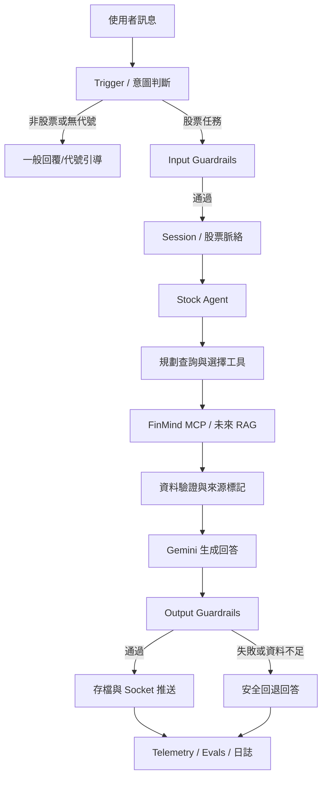

# 股票 AI 系統架構規格

## 1. 架構目標

本專案採用 Node.js / JavaScript 分層架構，將股票 AI、客服 AI 與未來其他領域 AI 共用的能力拆成可替換模組。

核心原則：

- 即時與歷史市場資料只能由 FinMind MCP 或其他已驗證資料來源取得，不可由模型記憶補數字。
- Agent負責「判斷、規劃、呼叫工具、整理結果」，資料來源不直接暴露給前端。
- Prompt、意圖、Session、Guardrails、工具與可觀測性彼此解耦。
- 股票回答預設附上資料來源、查詢日期與投資免責聲明。
- 所有模型呼叫都記錄延遲、嘗試次數、錯誤與 Token 使用量，但不得記錄金鑰或完整敏感個資。

## 2. 現有模組對照 

| 能力 | 本專案現況 | 對應模組/位置 | 狀態 |
|---|---|---|---|
| 共用 LLM | Gemini 文字生成與重試 | `src/ai/core/gemini.js` | 已具備基礎 |
| MCP 工具 | FinMind MCP → Gemini Tool | `src/ai/tools/finmind.js`、`mcp/client.js` | 已具備 |
| 股票意圖 | 關鍵字與代號解析 | `src/ai/stock/intent.js` | 已具備 |
| 股票觸發 | 判斷何時呼叫 Agent | `src/ai/stock/trigger.js` | 已具備 |
| 股票 Prompt | 資料來源與免責規則 | `src/ai/stock/prompt.js` | 已具備 |
| 股票 Session | 追蹤代號與近期問答 | `src/ai/stock/session.js` | 已具備 |
| 股票 Agent | MCP 工具呼叫與回答編排 | `src/ai/stock/agent.js` | 已具備雛形 |
| 群組聊天室整合 | Bot帳號、訊息持久化、Socket推送 | `src/services/groupStockAi.js` | 已具備 |
| 客服 AI | 獨立聊天助手 | `src/ai/agents/customerService.js` | 已具備 |
| 自動評估 | 固定題庫驗證意圖、Prompt | `test/stock-ai.eval.test.js` | 已具備 |
| 可觀測性 | Winston 記錄 LLM 延遲、Token、錯誤 | `src/ai/core/gemini.js`、`src/services/groupStockAi.js` | 已具備基礎 |
| 安全護欄 | 股票輸入與輸出檢查 | `src/ai/guardrails/stockGuardrails.js` | 基礎版，待擴充 |
| RAG | 目前使用 MCP 即時資料，尚無長期文件索引 | 未落地向量資料庫 | 可按需加入 |
| Fine-tuning | 未微調模型，統一使用雲端模型 API | 不建議在當前階段做 | 待產品資料成熟後評估 |

## 3. 建議目標目錄

```text
backend/src/ai/
  core/
    provider.js          # Gemini/OpenAI 等模型供應商介面
    model-router.js      # 依任務、成本、延遲選擇模型
    telemetry.js         # Trace、Token、成本、延遲統計
  agents/
    stock-agent.js       # 股票 Agent編排
    customer-agent.js    # 客服 Agent編排
  guardrails/
    input.js             # Prompt injection、長度、敏感資訊、指令限制
    output.js            # 禁止杜撰、來源檢查、免責、格式檢查
    policies.js          # 投資、個資與操作政策
  rag/
    chunker.js           # 公司規章、財報、研究報告切片
    embeddings.js        # 向量化介面
    retriever.js         # pgvector/Pinecone/Qdrant檢索介面
  tools/
    finmind.js           # FinMind MCP工具適配器
    chat-tools.js        # 聊天室既有資料工具
  evals/
    datasets/            # 固定題庫與回歸案例
    judges.js            # LLM-as-a-Judge
    runners/             # Node test / Promptfoo runner
  prompts/
    stock.prompt.js
    customer.prompt.js
  sessions/
    room-session-store.js
  llmops/
    trace-store.js
    cost-policy.js
    redaction.js
```

短期不必一次導入完整目錄；優先抽出 Guardrails、Telemetry 與 Agent Runtime，降低現有股票流程的耦合。

## 4. Runtime 流程



## 5. 各模組的 Node.js 實作建議

### RAG

目前建議先不要為即時股價建立向量庫；MCP 查詢更適合行情、法人、營收與最新財報。

RAG 應優先用於：

- 公司研究報告
- 財報轉錄文字與重大訊息
- 投資政策、風險規範與服務內部知識
- 歷史公告與法說會文件

建議使用：

- LlamaIndex.TS 或 LangChain.js負責文件切片與 Retriever 抽象
- pgvector（已使用 PostgreSQL / Prisma）作為初期首選，避免額外運維平台
- Embeddings 與 LLM分開設定，便於替換供應商
- 檢索結果必須帶來源文件、頁碼、時間與可信度，不可只帶文字片段

不建議把即時數字儲存在知識庫後直接回答，除非資料更新管線有明確時間戳與刷新機制。

### Agents

短期可先保留原生 JavaScript orchestration，不急著引入完整 Agent 框架。

現有股票流程已具備 Agent雛形：

1. Trigger 判斷任務
2. Session 維持追蹤代號
3. MCP 提供工具
4. Gemini 呼叫工具並整合結果
5. Fallback處理失敗
6. 結果存回聊天室

若後續擴充「搜尋、回測、風險評估、報告產生」，再引入 LangGraph.js 或 Mastra；它們可協助建立明確 state、tool loop、人工審核與多步工作流。

股票 Agent應限制權限：只允許查詢資料、計算衍生指標與產出文字，不允許下單、轉帳或修改持倉。

### Fine-tuning

目前不建議微調：固定格式與資料正確性可由 Prompt、工具與 Guardrails更安全地處理。

未來若需要微調，應先累積：

- 已人工驗證的繁體中文股票問答
- 固定回答格式資料
- 不可回答類型與拒絕樣本
- 風險用語與投資免責樣本

微調產物仍應透過雲端 API 呼叫；Node.js負責版本管理與路由，不負責訓練 GPU流程。

### Guardrails

至少分為輸入與輸出兩層。

輸入規則：

- 限制訊息長度與特殊指令比例
- 偵測 Prompt Injection，例如要求忽略系統規則、洩漏 Prompt 或假裝系統管理員
- 防止使用者要求下單、取得密碼、API Key或個資
- 區分股票事實查詢、個人化投資建議與一般閒聊

輸出規則：

- 禁止未使用工具來源的即時行情數字
- 回答中要求資料來源、查詢日期與日期範圍
- 固定投資免責聲明
- 不得保證報酬、保證買賣時機或以絕對語氣建議操作
- 工具失敗時只能回退，不得自行補數字
- 遮罩個人資料與機密設定資訊

### Evals

現有 Node test固定題庫適合作為第一層 Deterministic Eval。

建議至少增加：

- 觸發準確度：避免誤觸一般聊天
- 代號解析正確率
- 工具使用率：涉及即時資料時是否真的呼叫 MCP
- 忠實度：回答數字是否可由工具結果驗證
- 來源完整度：是否包含 FinMind與查詢日期
- 安全性：是否拒絕保證報酬或操作指示
- 追問一致性：是否沿用正確股票代號與Session

可再分階段使用：

1. Node.js test：CI必須通過，零外部成本。
2. Promptfoo：批次測試模型版本與Prompt回歸。
3. LLM-as-a-Judge：只對抽樣案例評估語意、相關性與忠實度。
4. 人工抽查：重大資安、投資風險與高影響回答。

### LLMOps

建議每次股票 Agent執行記錄一筆結構化 Trace：

- `traceId`
- `roomId`（或匿名會話ID）
- `model`
- `symbol`
- `replyPath`
- `mcpToolReady`
- `attempts`
- `inputTokens`
- `outputTokens`
- `totalTokens`
- `latencyMs`
- `errorCode`
- `promptVersion`
- `toolVersion`

應建立告警：

- MCP連線失敗率升高
- 429/503/504比例升高
- 回答平均延遲超過門檻
- 空回答與Fallback比例升高
- 單日/單用戶成本異常

可選用 Langfuse完整 Trace與Prompt版本；規模較小時可先維持 Winston結構化日誌，再定期匯出到資料庫或BI工具。

## 6. 分階段落地

### 第一階段：現況穩定化

- 把股票流程拆成 Trigger、Session、Agent、Guardrails、Telemetry
- 將模型與 MCP呼叫集中到單一 Runtime介面
- 固定輸出資料來源與免責聲明
- 補足固定題庫與CI評估

### 第二階段：增加RAG與工具治理

- 優先處理高價值文件：財報、公告、研究報告、產品政策
- 引入 pgvector與版本化文件索引
- 建立工具白名單、資料新鮮度規則與來源驗證

### 第三階段：完整Agent與LLMOps

- 引入 LangGraph.js / Mastra處理多步任務
- 建立 Langfuse Trace與Prompt版本
- 建立模型路由、成本上限與人工審核

### 第四階段：僅在資料成熟後微調

- 收集人工標註與通過安全評估的資料集
- 優先微調格式與語氣，不微調即時事實
- 金融事實仍繼續交由 MCP / RAG提供

## 7. 非目標

- 不把股票 AI 直接實作為可自動下單的交易代理。
- 不以模型生成內容取代歷史、即時或法人資料。
- 不在日誌中保存使用者完整敏感內容、API Key或未遮罩個資。
- 不在沒有資料來源驗證的情況下聲稱特定投資保證與報酬。
