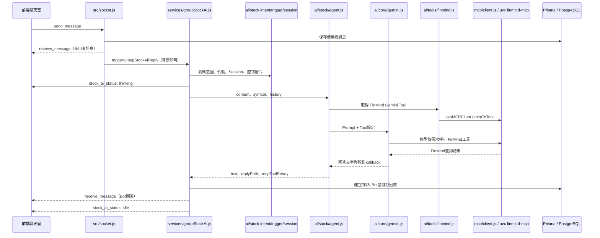

# 後端 AI 現況架構

> 本文件描述目前程式實際執行方式，不代表尚未實作的目標架構。盤點範圍包括 `backend/src/`、`backend/mcp/`、股票 AI 評估測試與後端套件設定。

## 1. 一頁總覽

目前後端有兩條 AI 功能路徑：

1. **群組股票 AI**：Socket訊息觸發 → 股票意圖與 Session判斷 → Stock Agent → Gemini呼叫 FinMind MCP工具 → Bot訊息寫入資料庫 → Socket推送回聊天室。
2. **AI客服**：已登入使用者呼叫 HTTP API → 客服 Agent → Gemini → API回傳客服文字。

股票路徑使用 MCP；客服路徑不使用 MCP。RAG、向量資料庫、Fine-tuning、LangGraph、Mastra、Langfuse、Promptfoo目前都沒有接入。

## 2. 目前目錄與責任

```text
backend/
├─ mcp/
│  └─ client.js                      FinMind MCP stdio Client；啟動 uvx finmind-mcp
├─ src/
│  ├─ index.js                       Express/HTTP/Socket.IO 啟動、路由掛載、預熱 MCP
│  ├─ socket.js                      Socket.IO事件與聊天訊息處理；呼叫群組股票橋接
│  ├─ routes/
│  │  └─ ai.js                       POST /api/ai/chat：認證、解析要求、回傳客服結果
│  ├─ services/
│  │  └─ groupStockAi.js             Socket與股票 Agent的應用層橋接；Bot/Prisma/Socket
│  ├─ ai/
│  │  ├─ index.js                    AI模組 barrel export（目前非主要呼叫入口）
│  │  ├─ core/
│  │  │  └─ gemini.js                Gemini client、回應解析、暫時錯誤重試、Token與延遲 callback
│  │  ├─ agents/
│  │  │  └─ customerService.js       客服 Prompt、輸入長度驗證、Gemini呼叫與錯誤Fallback
│  │  ├─ stock/
│  │  │  ├─ agent.js                 股票 Agent；輸入檢查、Prompt、MCP工具、輸出檢查
│  │  │  ├─ intent.js                股票關鍵字、4碼股票代號判斷
│  │  │  ├─ trigger.js               觸發、結束與重置規則
│  │  │  ├─ session.js               程序內房間股票追問狀態
│  │  │  ├─ prompt.js                股票查詢規則與歷史對話組裝
│  │  │  └─ index.js                 股票模組匯出
│  │  ├─ tools/
│  │  │  └─ finmind.js               MCP Client轉為 Gemini可呼叫的 Tool
│  │  └─ guardrails/
│  │     └─ stockGuardrails.js       股票輸入/輸出簡單規則檢查
│  └─ utils/
│     └─ logger.js                   Winston日誌（AI程式透過此記錄器記錄）
└─ test/
   └─ stock-ai.eval.test.js          不呼叫外部模型的股票規則回歸測試
```

一般業務的 `auth.js`、`chat.js`、`friends.js`、`profile.js` 等仍留在 `services/`。這些是應用服務，不是 AI副本。AI相關的 `services/groupStockAi.js` 目前也保留，因為它執行聊天室應用整合，不等於 Agent邏輯。

## 3. 群組股票 AI實際流程



實際行為：

- Socket先保存並廣播使用者訊息，再不等待股票 AI完成就發出背景呼叫；Socket ack不會等待模型結果。
- Trigger在沒有股票 Session時，依4碼代號或關鍵字判斷；有效 Session存在時可直接追問。
- `結束`、`重置`等命令只在有效 Session時處理。
- 股票 Agent把 MCP Tool交給 Gemini SDK；資料集選擇/工具呼叫由模型SDK流程處理，FinMind MCP再向 FinMind API取資料。
- 群組橋接建立/尋找 Bot使用者、加入聊天室、將 AI回答寫入 `message`，並沿用既有 `receive_message` Socket事件格式。
- Agent成功/失敗 callback及群組橋接會寫入 Winston結構化字串/日誌，包含延遲、Token、重試次數、symbol、replyPath等欄位。

## 4. AI客服實際流程

```text
前端客服 UI
  -> POST /api/ai/chat
  -> verifyToken
  -> src/routes/ai.js
  -> src/ai/agents/customerService.js
  -> src/ai/core/gemini.js 的 generateAiText
  -> Gemini API
  -> successResponse / errorResponse
```

客服服務檢查訊息非空且不超過100字，套用固定 Chat App客服 Prompt，並使用共用 `generateAiText()` 呼叫 Gemini。它會沿用暫時性錯誤重試，成功時記錄 Token、耗時、嘗試次數與客服 `requestId`；失敗時記錄錯誤代碼並由客服自身的Fallback規則處理。客服不呼叫 FinMind MCP，也不使用股票 Prompt或股票 Session。

## 5. Agent、模型與 MCP責任邊界

| 元件 | 現在負責 | 不負責 |
|---|---|---|
| `src/services/groupStockAi.js` | 聊天室 Bot、Prisma讀寫、Socket狀態與訊息事件、股票流程協調/Fallback | 不建立 MCP Client，也不定義 Gemini SDK本身 |
| `src/ai/stock/agent.js` | 股票問題安全檢查、組合 Prompt、取得工具、呼叫生成入口、檢查生成文字 | 不存取 Prisma/Socket，不管理 Bot使用者 |
| `src/ai/core/gemini.js` | 單例 Gemini Client、文字抽取、暫時錯誤重試、Token與延遲 callback | 不處理聊天資料庫或客服HTTP回應 |
| `src/ai/tools/finmind.js` | `mcpToTool()` adapter | 不自行啟動另一個 FinMind服務 |
| `backend/mcp/client.js` | MCP Client、stdio transport、`uvx finmind-mcp`啟動、Token環境映射與部分日誌遮罩 | 不管理 UI/Socket |
| `src/ai/agents/customerService.js` | 客服輸入檢查、Prompt、共用生成入口、客服指標與Fallback | 不查股票或呼叫 MCP |

## 6. 狀態與資料生命週期

- 股票 Session存在 `session.js` 的程序內 `Map`，TTL 15分鐘，最多保留4輪問答，每輪問題/回答各截短至600字。
- 因 Session是記憶體狀態，後端重啟會清除；多個 Node/PM2 instances不會共享狀態，也沒有資料庫持久化。
- 股票 Bot訊息使用 Prisma持久化到聊天室訊息資料表；Session本身不持久化。
- `mcp/client.js`使用模組變數單例連線；`src/index.js`在 HTTP服務啟動後預熱MCP，失敗會記錄錯誤。
- 使用者 Socket訊息與Bot回覆的即時事件仍由聊天室前端既有事件處理，不要求前端知道模型/MCP細節。

## 7. 已使用套件與外部服務

- `@google/genai`：Gemini模型API、`mcpToTool()`。
- `@modelcontextprotocol/sdk`：MCP Client與stdio transport。
- `uvx finmind-mcp`：Python發行的 FinMind官方 MCP子程序，由 `mcp/client.js` 啟動。
- `express`、JWT認證與專案 response handler：客服 HTTP入口。
- `socket.io`：群組聊天室即時事件。
- `@prisma/client`：Bot使用者、房間會員與訊息存取。
- `bcryptjs`、`crypto`：建立 Bot帳號密碼雜湊與隨機密碼。
- `winston`：服務日誌與AI執行指標。

後端 `package.json` 沒有安裝 LangChain.js、LlamaIndex.TS、LangGraph.js、Mastra、pgvector client、Promptfoo、Langfuse或其他 AI框架套件。

## 8. 評估測試現況

`npm run eval:stock-ai`執行 `node --test test/stock-ai.eval.test.js`。題目涵蓋意圖判斷、股票代號解析、觸發、Prompt規則與最近問答脈絡；不呼叫 Gemini或 FinMind，因此不產生模型/API流量費用。

它目前不是端到端 Agent測試：沒有驗證真實MCP工具呼叫、工具返回資料與最終回答一致性、資料來源/日期是否確實出現在回答、或真人品質評分。

## 9. 現況限制與注意事項

1. **Guardrails屬簡單字串規則**：輸入只比對少量注入字樣、空內容與長度；輸出只檢查空字串與特定保證獲利用語。不是完整 Prompt Injection偵測，也沒有驗證每個數字/來源是否真的來自工具。
2. **Prompt要求不是程式保證**：要求 FinMind、資料日期與免責聲明，但程式沒有結構化解析工具結果或強制驗證來源欄位。
3. **用量指標的限制**：目前成功回應會記錄Token與耗時；若某次失敗請求後重試，該失敗嘗試的Token用量不一定能取得或納入統計，因此日誌不是精算帳單。
4. **Session不適用多實例共享**：PM2 cluster/多副本部署時可能發生同一房間各自看到不同 Session。
5. **目前沒有 RAG**：無文件載入、chunking、embedding、Retriever或向量資料庫。
6. **目前沒有 Fine-tuning/Agent框架/LLMOps平台**：Agent是原生 JS編排；指標寫Winston日誌，沒有集中 Trace、成本儀表板、Prompt版本平台。
7. **外部股票資料依賴 FinMind MCP可用性與模型工具呼叫**：MCP連不上或模型故障時會回Fallback文字，不會提供離線股價資料。

## 10. 重要環境設定

- `GOOGLE_API_KEY`：Gemini API金鑰。
- `GEMINI_MODEL`：模型名稱；預設 `gemini-3.1-flash-lite`。
- `FINMIND_TOKEN`：FinMind MCP使用的Token。
- `FINMIND_API_TOKEN`：相容舊環境變數；啟動 MCP時映射為 `FINMIND_TOKEN`。
- `FINMIND_MCP_COMMAND`：選用，覆寫預設 `uvx`執行命令。
- `UV_SYSTEM_CERTS`：選用；本專案預設使用 `1`，支援 Windows企業憑證環境。

## 11. 現況結論

目前是「**原生 JavaScript的雙路徑 AI服務**」：股票 Agent走 Gemini + FinMind MCP，客服 Agent走 Gemini API；聊天、Socket、Prisma由應用層維持。AI核心已從通用 `services/`整理到 `src/ai/`，但群組股票聊天室橋接仍合理留在 `src/services/groupStockAi.js`，因為它負責實際的聊天室副作用與連線契約。
